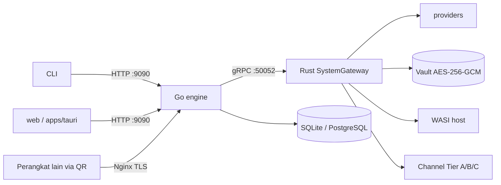

# 02 — Permukaan Aktif, Migrasi UI/Desktop, & Status Warisan

## 1. Keputusan Owner (ODR-01, 2026-10-04)

UI aktif di **`web/`**, desktop aktif di **`apps/tauri/`**. Kode lama ClawCrew di kedua lokasi **sudah diganti** dengan kode Galleon (sebelumnya `web-2/` dan `apps/tauri-2/`, kini terhapus). Dokumen lama yang menyebut `web-2`/`tauri-2` adalah alias untuk `web/`/`apps/tauri/`.

| | Sebelum | Sekarang (working tree) |
|---|---|---|
| UI | `web/` = dashboard ClawCrew; `web-2/` = Galleon | `web/` = Galleon (nama paket masih `react-example`, ada `server.ts` Express) |
| Desktop | `apps/tauri/` = `clawcrew-desktop`; `apps/tauri-2/` = Galleon | `apps/tauri/` = `fleet-ai-desktop` (id `com.galleon.sovereign`) |

## 2. Dampak migrasi yang masih menggantung (terverifikasi)

| # | Temuan | Bukti | Tiket |
|---|---|---|---|
| M1 | `frontendDist` menunjuk path yang sudah tidak ada | `apps/tauri/tauri.conf.json`: `../../web-2/dist` → harus `../../web/dist` | U-01 |
| M2 | `Cargo.toml` root masih meng-embed `/web/dist/**/*` ke binary root, padahal isinya kini UI Galleon | `Cargo.toml` `include` | P-03 |
| M3 | Semua `Dockerfile*` menyiapkan stub `apps/tauri/{src/main.rs,build.rs}` dan meng-copy `web/dist` | `Dockerfile`, `.alpine`, `.debian`, `.ci` | P-02 |
| M4 | Vite proxy ke `ENGINE_URL` (default `http://127.0.0.1:9090`) — selaras arsitektur | `web/vite.config.ts` | — |
| M5 | `web/` adalah export Google AI Studio: `metadata.json`, `bun.lock` + `package-lock.json`, `.github/`, `Dockerfile`, `docker-compose.yml`, `nginx.conf`, `DEPLOYMENT.md`, `data/`, `docs/`, `@google/genai`, `better-sqlite3` | ODR-08 | U-05 |
| M6 | Nama paket UI `react-example` | `web/package.json` | U-05 |
| M7 | Tidak ada skrip `test`; `lint` = `tsc --noEmit` | `web/package.json` | U-12 |
| M8 | Test/CI desktop ditulis untuk `clawcrew-desktop` (nama paket berubah) | `tests/architecture/desktop_release.rs`, `desktop-check.yml` | P-05 |

## 3. Status komponen

| Komponen | Status | Catatan |
|---|---|---|
| `web/` | aktif | melanggar ADR 0002 (`server.ts`) → U-02/U-03 |
| `apps/tauri/` | aktif | melanggar ODR-07 (`execute_terminal_command`) + data palsu → U-06/U-07 |
| `engine/` (Go) | aktif | otak tunggal |
| `crates/*` (Rust) | aktif | sebagian besar `galleon-runtime` & REST gateway adalah fungsi era ClawCrew (§4) |
| `src/` binary, `apps/galleoncode`, `apps/galleonrelay` | perlu klasifikasi | asumsi A1: CLI = klien tipis ke Go → R-00 |

## 4. Risiko arsitektur terbesar: "dua otak"

`galleon-runtime` (286k LOC) memuat agent loop, SOP, subagents, cron, memory strategy, skills. Menurut boundary dan ODR-03, otak agent adalah **Go**; Rust adalah **System Core**. Dua otak berarti state ganda (melanggar SSOT), kerja memecah kode yang seharusnya dihapus/dipindah, dan permukaan serangan lebih besar.

**Tiket pertama jalur Rust = R-00: klasifikasi modul runtime (keep / move-to-Go / delete / feature-gate)** sebelum pemecahan crate lanjutan. Tidak ada penghapusan tanpa sign-off Owner.

## 5. Memilih target perubahan

| Pekerjaan | Edit di | Jangan |
|---|---|---|
| Fitur UI | `web/src` | logika backend di `web/server.ts` |
| Shell desktop | `apps/tauri` (proxy ke Go + fitur OS) | logika bisnis, shell, data palsu |
| Orkestrasi, policy, approval, memori | `engine/src/<domain>` | Rust / UI |
| LLM, tool native, vault, sandbox, channel, WASI | `crates/*` | Go |
| Kontrak Go↔Rust | `proto/` + `tech-standart/api-contracts/` dalam satu PR | salah satu saja |
| Kontrak plugin | `wit/` (v0 beku; breaking → `wit/v1/`) | edit breaking di v0 |

## 6. Kontrak lintas-tier (terverifikasi)

- `AgentEngine`: `StartTurn` (stream), `QuickQuery`, `HealthCheck`. `SystemGateway`: `ExecuteNativeTool`, `GetDecryptedSecret`, `ExecuteTask`, `ExecuteTurn` (stream).
- Rust: `execute_turn` dan `get_decrypted_secret` nyata; **`execute_task` stub**.
- Go client `engine/pkg/client/system_gateway.go`: dial lazy `localhost:50052`, timeout 400 ms, `ExecuteNativeTool` fail-closed. `engine/src/llm/` tidak ada.
- WIT `clawcrew:plugin@0.1.0`, `.frozen` ada.

## 7. Alur data

Pelanggaran saat ini: `web/server.ts` (QR, telemetri), Tauri `execute_terminal_command`, Go `tool/` shell/fs lokal, penyimpanan masih JSON/JSONL.
