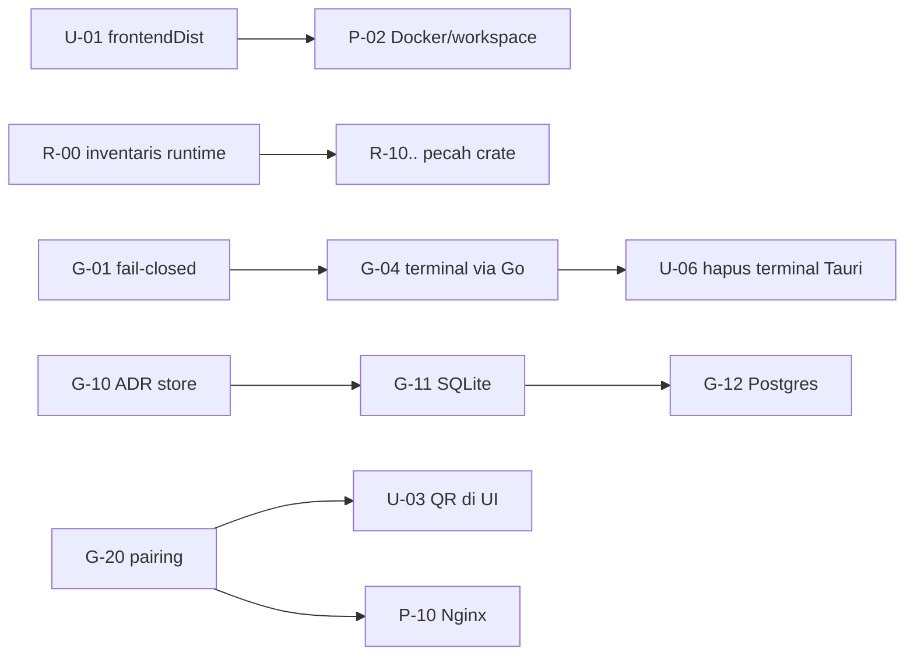

# Galleon Roadmap — Master Task Breakdown

> **Dasar:** `decisions/owner-decisions/ODR-2026-10-04-product-direction.md`, `product/galleon-product-definition.md`, `foundation/`.
> **Aturan:** semua kotak `[ ]` = belum dikerjakan. Centang hanya setelah DoD tiket terpenuhi dan bukti (PR/commit) dicatat di baris tiket.
> **Tidak menduplikasi** `decisions/finalize/task-breakdown.md` (GRUP 0–8) dan Phase 5 Rust; keduanya dirujuk lewat kolom *Ref*.

## Lane

| Lane | File | Cakupan |
|---|---|---|
| R | [`R-rust.md`](R-rust.md) | Rust: klasifikasi runtime, gerbang kualitas, pemecahan crate, hardening, plugin |
| G | [`G-go-engine.md`](G-go-engine.md) | Go: fail-closed, persistensi SQLite/Postgres, memori, QR/pairing, terminal ber-policy |
| U | [`U-ui-desktop.md`](U-ui-desktop.md) | `web/` dan `apps/tauri/` |
| P | [`P-platform-release.md`](P-platform-release.md) | Workspace, Docker, CI, Nginx/VPS, rilis |
| D | [`D-docs-hygiene.md`](D-docs-hygiene.md) | Drift dokumen, errata ADR, kebersihan repo |
| N | [`N-rename-and-legacy-cleanup.md`](N-rename-and-legacy-cleanup.md) | Rebrand ke Galleon + hapus legacy (ODR-16) |

## Rencana PR & gerbang review

[`PR-plan.md`](PR-plan.md) memetakan semua tiket ke PR/branch, gerbang DoD (GW-0..GW-9), branch integrasi per gelombang, dan checklist Principle.

## Legenda

- ID: `<lane>-<nn>`. Prioritas **P0** (keamanan/rusak) → **P1** (fondasi produk) → **P2** (kualitas) → **P3** (lanjutan).
- Ukuran: **S** ≤0,5 hari, **M** ≤2 hari, **L** ≤1 minggu, **XL** perlu dipecah.
- `Dep` = tiket yang harus selesai dulu. Tidak boleh ada siklus.
- Setiap tiket: *Scope* (file), *Acceptance* (terverifikasi), *Out of scope*.

## Jalur kritis (urutan yang disarankan)

## Papan status (perbarui saat tiket selesai)

| Lane | Total | Selesai |
|---|---|---|
| R | 28 | 0 |
| G | 23 | 0 |
| U | 14 | 0 |
| P | 12 | 0 |
| D | 10 | 0 |
| N | 22 | 0 |

## Gelombang

1. **Gelombang 0 (P0):** **R-00 (prioritas utama)**, N-00, N-01, N-10, U-01, U-06, G-01, P-01, D-01.
2. **Gelombang 1 (hapus dulu, baru rename):** N-11..N-14 sebelum N-2x; gerbang kualitas (R-01..R-04, P-04, P-05), G-04, U-02/U-03/U-05, G-10.
3. **Gelombang 2:** persistensi (G-11..), pairing (G-20..), pemecahan crate (R-10..), Nginx (P-10).
4. **Gelombang 3:** WASI/plugin, rilis, pembelajaran memori.
