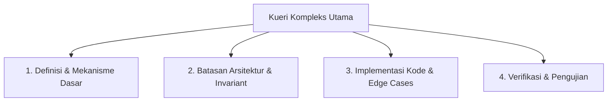

# Standard Operating Procedure (SOP) Riset & Investigasi Teknis

**Status:** Normative Technical Guideline  
**Domain:** Agent Research Methodology  
**Reference:** R-94, Perplexity Decomposition Pattern  

---

## 1. Tujuan dan Ruang Lingkup

SOP ini menetapkan standar dekomposisi kueri, penyaringan domain, dan penelusuran sumber rujukan (provenance citation) saat melakukan riset teknis atau analisis arsitektur sebelum mengeksekusi perubahan kode besar.

---

## 2. Metodologi Dekomposisi Kueri (Query Decomposition)

Kueri teknis yang kompleks atau multitafsir tidak boleh dicari secara utuh (monolitik). Peneliti atau agent wajib memecah kueri menjadi 3–5 sub-kueri atomic dengan tujuan spesifik:



### Contoh Dekomposisi:
- **Kueri Monolitik:** *"Bagaimana cara mitigasi memory leaks pada rust FTS5 sqlite connection?"*
- **Sub-kueri Terdekomposisi:**
  1. `rusqlite fts5 connection lifecycle cleanup`
  2. `sqlite3 memory leak prepared statement finalize`
  3. `rust drop implementation for sqlite wrapper`
  4. `valgrind / leak-sanitizer for cargo nextest`

---

## 3. Penyaringan Domain & Sumber Primer (Domain Filtering)

Pencarian wajib memprioritaskan sumber primer berotoritas tinggi untuk meminimalkan halusinasi:

### Tier 1 (Otoritas Mutlak - Bobot 1.0):
- Upstream Official Documentation (cth: `doc.rust-lang.org`, `golang.org/doc`, `sqlite.org`)
- RFC, PEP, atau ADR yang telah difinalisasi
- Upstream source code repository resmi

### Tier 2 (Otoritas Tinggi - Bobot 0.8):
- Release notes resmi, issue tracker resmi dengan status `closed/resolved`
- Buku pegangan resmi (cth: *The Rustonomicon*, *Effective Go*)

### Tier 3 (Otoritas Sekunder - Verifikasi Wajib):
- Blog teknis pihak ketiga, StackOverflow, GitHub discussions
- Informasi dari Tier 3 tidak boleh dijadikan acuan tunggal tanpa verifikasi empiris di kode lokal.

---

## 4. Pelacakan Sumber & Sitasi (Citation Tracking)

Setiap kesimpulan atau aturan baru yang dimasukkan ke Knowledge Graph (`galleon-memory`) atau proposal pembelajaran (`MemoryProposal`) wajib menyertakan atribut sitasi konkret (URI atau path berkas):

```json
{
  "rule": "Pastikan statement rusqlite selalu di-drop sebelum koneksi ditutup",
  "citations": [
    "https://docs.rs/rusqlite/latest/rusqlite/struct.Statement.html",
    "crates/galleon-memory/src/knowledge_graph.rs#L45"
  ]
}
```

Metode `verify_citations()` pada `KnowledgeNode` akan memvalidasi bahwa setiap sitasi memiliki skema yang valid (`https://`, `http://`, atau `file:///`).
